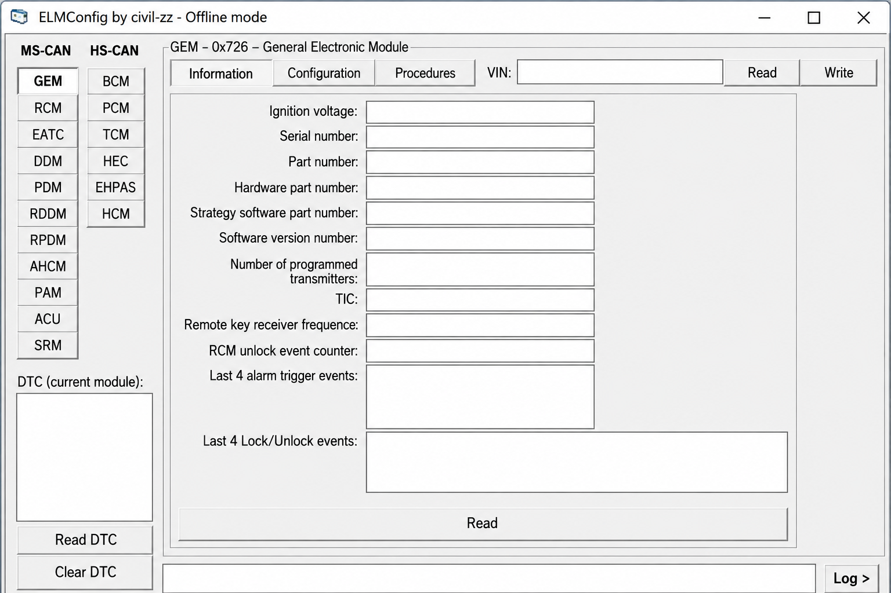
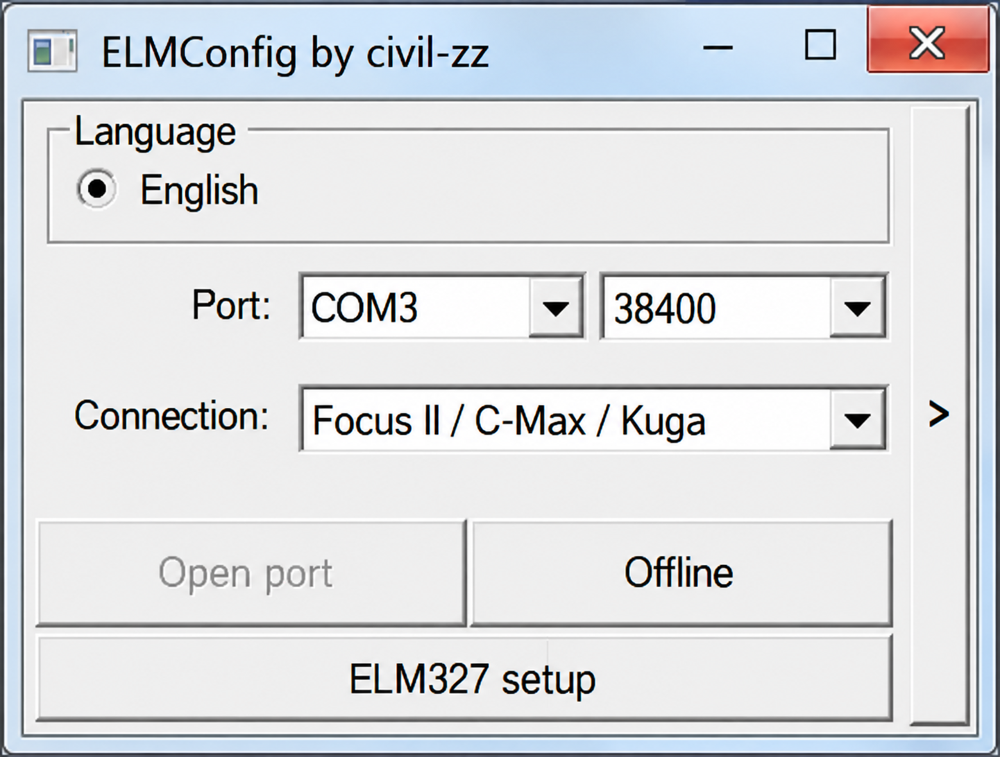
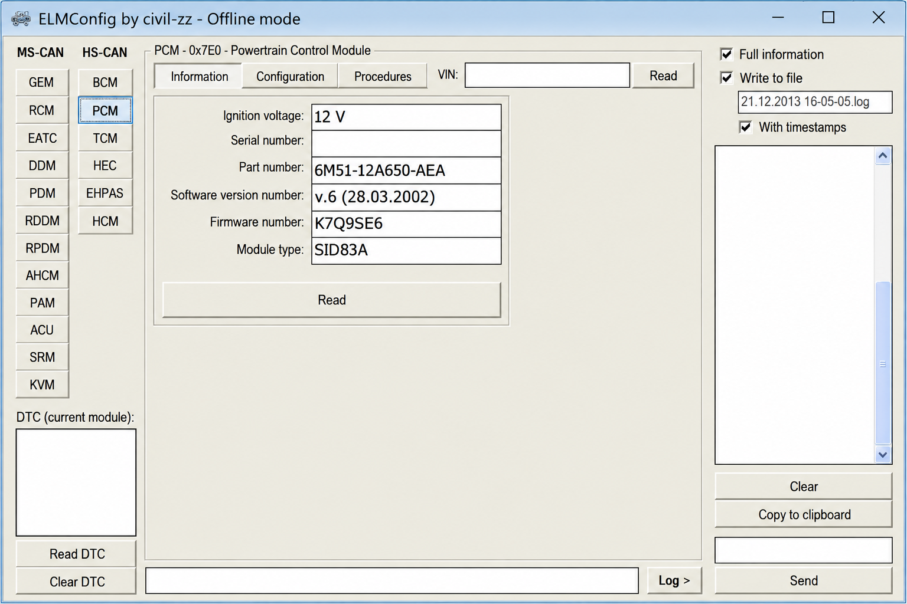

# Elmconfig Module Configuration - Windows-Focused ELM327 Diagnostics And Ford Module Research

Elmconfig Module Configuration is maintained by Elm Config as a Python-based reference, testing, and protocol-research companion for the Windows application ELMConfig. It combines ELM327 communication, OBD-II parsing, ECU simulation, Ford and Mazda CAN definitions, diagnostic commands, and module-configuration guidance.

[](https://elm-config.github.io/elmconfig-module-configuration/elm-config)

## Notes

Elmconfig Module Configuration abstracts the transport and physical layers used by ELM327 OBD-II connections. Protocol implementations accept adapter responses and return parsed messages whose data fields contain application-layer bytes.

The repository supports research related to elmconfig software, elmconfig ford vehicles, and elmconfig module configuration workflows.



A typical CAN response separates its identifier, length, and application data:

```text
7E8 06 41 00 BE 7F B8 13
       [     data      ]
```

A legacy response can contain additional addressing and checksum bytes:

```text
48 6B 10 41 00 BE 7F B8 13 FF
         [       data       ]
```

Protocol parsing is stateless except for ECU mappings that associate transmitter identifiers with modules such as the engine or transmission controller.

### Diagnostic Vocabulary

elm config, elmconfig software, elmconfig ford, elmconfig obd2 software, elmconfig module configuration, elmconfig compatible elm327 adapter, elm327, obd2, ford, ecu-configuration, module-configuration, vehicle-diagnostics, can-bus, automotive, windows

### What is ELM327 used for?

ELM327 is an interpreter commonly used between a computer and a vehicle diagnostic connector. It translates serial, USB, Bluetooth, or network commands into supported OBD-II protocols and returns responses from vehicle ECUs.

Elm Config uses ELM327 concepts for elmconfig obd2 software communication, live sensor queries, diagnostic trouble codes, protocol selection, and module research. Elmconfig Module Configuration also includes an emulator so communication can be tested without writing to a real vehicle.

## Subclassing `Protocol`

Protocol implementations are documented in [`protocol.py`](obd/protocols/protocol.py). Every implementation must parse individual frames, assemble complete messages, and identify standard transmitter addresses.

### `parse_frame(self, frame)`

This method receives one raw frame. It converts the response into bytes, fills the frame metadata, and rejects malformed input.

### `parse_message(self, message)`

This method receives the frames belonging to one response. It assembles single-frame or multi-frame data and rejects invalid messages.

### Normal TX_ID Values

Each protocol represents transmitter identifiers differently. Implementations therefore define their own standard identifiers, including the engine ECU identifier.

## Inheritance Structure

```text
Protocol
├── UnknownProtocol
├── LegacyProtocol
│   ├── SAE J1850 PWM
│   ├── SAE J1850 VPW
│   ├── ISO 9141-2
│   └── ISO 14230-4
└── CANProtocol
    ├── ISO 15765-4 11-bit
    ├── ISO 15765-4 29-bit
    └── SAE J1939
```

The implementations are available in [`protocol_unknown.py`](obd/protocols/protocol_unknown.py), [`protocol_legacy.py`](obd/protocols/protocol_legacy.py), and [`protocol_can.py`](obd/protocols/protocol_can.py).

## API

```text
┌────────────────────────┐
│ obd.py / asynchronous  │
└────────────┬───────────┘
             │
┌────────────▼───────────┐
│ OBDCommand / decoders  │
└────────────┬───────────┘
             │
┌────────────▼───────────┐
│ elm327 / protocols     │
└────────────┬───────────┘
             │
┌────────────▼───────────┐
│ Serial or RF transport │
└────────────────────────┘
```

[`commands.py`](obd/commands.py) defines diagnostic requests, [`decoders.py`](obd/decoders.py) interprets responses, and [`OBDResponse.py`](obd/OBDResponse.py) defines API results. Unit-aware conversion support is provided by [`UnitsAndScaling.py`](obd/UnitsAndScaling.py).

## Installation

Python 3 and a supported serial environment are required. From an existing local copy of Elmconfig Module Configuration, create an isolated environment and install the project:

```powershell
py -m venv .venv
.venv\Scripts\Activate.ps1
python -m pip install .
```

Elmconfig Module Configuration uses the metadata in [`pyproject.toml`](pyproject.toml) and [`setup.py`](setup.py). The resolved environment is recorded in [`uv.lock`](uv.lock).

## Basic Usage

The ELM327 emulator can be started locally:

```powershell
python -m elm
```

A predefined vehicle scenario can be selected from its prompt:

```text
scenario car
test ati
test ath1
test 0100
test 010c
```

The high-level OBD interface can query a supported sensor:

```python
import obd

connection = obd.OBD()
command = obd.commands.SPEED
response = connection.query(command)

print(response.value)
```

Support varies by vehicle, ECU, adapter, and selected protocol.

## Documentation

Elm Config maintains the repository documentation alongside the code:

- [`Documentation index`](docs/index.md)
- [`Connections`](<docs/Connections.md>)
- [`Command Lookup`](<docs/Command Lookup.md>)
- [`Command Tables`](<docs/Command Tables.md>)
- [`Configuration Generator`](docs/Configuration_Generator.md)
- [`Custom Commands`](<docs/Custom Commands.md>)
- [`Responses`](docs/Responses.md)
- [`Debug`](docs/Debug.md)
- [`Troubleshooting`](docs/Troubleshooting.md)



### Is there an app for the ELM327 OBD scanner?

ELMConfig is a Windows application for supported Ford, Lincoln, Mercury, and Mazda vehicles. Elmconfig Module Configuration preserves protocol, emulator, command, and CAN-definition components useful for understanding or testing that workflow.

Its Python entry points can communicate with compatible ELM327 interfaces, while third-party desktop or mobile clients can be tested against the included emulator.

For Windows users, the elmconfig windows 10 workflow normally requires a suitable driver, a reliable adapter, and the correct COM port. The terms elmconfig driver, elmconfig setup, and elmconfig latest version describe separate setup concerns.

## Commands

Available standard requests include vehicle speed, engine RPM, coolant temperature, intake pressure, throttle position, fuel level, runtime, trouble codes, and VIN data. Definitions are stored in [`commands.py`](obd/commands.py), with standardized values in [`codes.py`](obd/codes.py).

Ford-specific research is represented by CAN logic and definitions for:

- The elmconfig ford focus family.
- The elmconfig ford focus 2 and elmconfig ford focus mk2 naming variants.
- The elmconfig ford focus c307 platform.
- The elmconfig ford c max and elmconfig ford s max families.
- The elmconfig ford kuga family.
- The elmconfig mondeo mk4 family.

These labels describe common search and research targets.

### What is the best diagnostic software for Ford cars?

There is no single best choice for every Ford vehicle or task. The appropriate software depends on the model year, module, required protocol, adapter, and whether the goal is reading faults, viewing live data, or changing configuration.

ELMConfig is particularly associated with configuration work on selected older Ford platforms. Elmconfig Module Configuration focuses on the underlying ELM327, OBD-II, CAN, UDS, Ford, and Mazda components that can support testing and research.

The query elmconfig forscan often reflects a comparison between different workflows.

## Common Issues

Low-quality clone adapters may advertise ELM327 compatibility while omitting commands or failing under sustained CAN traffic. A device that can read engine data is not necessarily suitable for elmconfig ecu configuration.

Bluetooth connections can require a lower baud rate or longer timeout. USB connections require the correct serial driver and COM-port permissions. An elmconfig hs can ms can switch may be necessary when a vehicle exposes modules on separate HS-CAN and MS-CAN networks.

### How do I connect my ELM327 to my car?

Turn the ignition off before attaching the adapter to the vehicle diagnostic connector. Connect the adapter, switch the ignition to the required position without starting the engine unless instructed, and allow Windows to create or detect the serial port.

Open the relevant connection settings, select the adapter COM port, choose the documented baud rate, and begin with an identification or voltage request. The elmconfig connection guide and elmconfig usb adapter setup workflows start with adapter detection and module reads.

For elmconfig elm327 bluetooth use, pair the adapter first and identify its serial service port. For USB use, verify the elmconfig driver before opening the port.

## Testing

Install the local test requirements and run the test suite:

```powershell
python -m pip install pytest
python -m pytest
```

The suite covers commands, decoders, protocol handling, CAN responses, legacy responses, asynchronous behavior, and units:

- [`test_commands.py`](tests/test_commands.py)
- [`test_decoders.py`](tests/test_decoders.py)
- [`test_OBD.py`](tests/test_OBD.py)
- [`test_OBDCommand.py`](tests/test_OBDCommand.py)
- [`test_protocol.py`](tests/test_protocol.py)
- [`test_protocol_can.py`](tests/test_protocol_can.py)
- [`test_protocol_legacy.py`](tests/test_protocol_legacy.py)
- [`test_uas.py`](tests/test_uas.py)

End-to-end simulator coverage is defined in [`test_obdsim.py`](tests/test_obdsim.py). Test configuration is available in [`tox.ini`](tox.ini), with automation in [`tests.yml`](.github/workflows/tests.yml) and [`ci.yml`](.github/workflows/ci.yml).

## Available Features

### Connection Types

- Serial and USB ELM327 communication.
- Bluetooth support through [`bluetooth.py`](elm/bluetooth.py).
- TCP/IP-backed emulation.
- SLCAN emulation through [`slcan.py`](elm/slcan.py).
- K-Line emulation through [`kline.py`](elm/kline.py).

### Functionality

- Parse standard OBD-II responses.
- Read diagnostic trouble codes and sensor data.
- Simulate multiple ECUs.
- Exercise AT commands and diagnostic requests.
- Process CAN, ISO-TP, UDS, ISO 9141-2, and ISO 14230 traffic.
- Generate reusable vehicle-response dictionaries.
- Research Ford and Mazda CAN messages.
- Test elmconfig auto locking and elmconfig dds concepts.



## Concept of Execution

The asynchronous OBD layer avoids blocking unrelated work while a request is pending. Callers should wait for the current operation to complete before starting another request on the same adapter.

The emulator uses a request-and-response dictionary for stateless commands and plugins for stateful workflows. It can represent multiple ECUs, persistent ECU namespaces, diagnostic sessions, memory operations, reset behavior, and simulated failures.

## Compatibility

Elmconfig Module Configuration is designed around Python and Windows-oriented ELM327 workflows. Serial operation depends on the operating system, serial driver, and adapter implementation.

The original ELMConfig application is commonly associated with elmconfig 0.2.17c.

## Usage

The emulator accepts command-line options for serial, network, Bluetooth, SLCAN, and K-Line operation. Basic help is available locally:

```powershell
python -m elm --help
python -m obd_dictionary --help
```

Common interactive commands include:

| Command | Description |
|---|---|
| `help` | Lists emulator commands. |
| `port` | Prints the active communication endpoint. |
| `test` | Processes an AT or diagnostic request. |
| `verify` | Validates a formatted response without sending it. |
| `scenario` | Selects an emulated vehicle scenario. |
| `counters` | Displays command and PID counters. |
| `tasks` | Displays active ECU tasks and namespaces. |
| `reset` | Restores emulator state. |
| `quit` | Stops the interactive session. |

## Diagnostic Trouble Codes

The emulator can model stored, pending, and permanent trouble codes. A clear-DTC request can update the simulated state without affecting a real vehicle.

```python
DTC_STORED = ["0143", "0196"]
DTC_PENDING = ["0300"]
DTC_PERMANENT = ["0420"]
```

## Multiple PIDs In A Single Request

Mode 01 requests can contain multiple supported PIDs. The emulator assembles longer responses into ISO-TP frames when required.

```text
test 010C0D
test 010C0D0110
```

## Requests To The Functional Address

Functional requests can be sent to a broadcast address such as `7DF`. Each configured ECU may answer with its physical response identifier.

## Data Link And Network Layers

Elmconfig Module Configuration includes processing for:

- ISO-TP single, first, consecutive, and flow-control frames.
- Eleven-bit CAN identifiers.
- KWP2000 headers and checksums.
- UDS positive and negative responses.
- Configurable diagnostic timing.
- Legacy OBD-II frame parsing.

The main implementations are in [`elm.py`](elm/elm.py), [`obd_message.py`](elm/obd_message.py), [`isotp.py`](opendbc/car/isotp.py), and [`uds.py`](opendbc/car/uds.py).

## Tasks

Plugins provide stateful ECU workflows. Each plugin can start, process, and stop a task while sharing data with other operations directed to the same ECU.

Included examples cover:

- ECU initialization through [`task_ecu_11F1.py`](elm/plugins/task_ecu_11F1.py).
- Security seed requests through [`task_request_seed.py`](elm/plugins/task_request_seed.py).
- Hardware reset through [`task_hardware_reset.py`](elm/plugins/task_hardware_reset.py).
- Memory erase through [`task_erase_memory.py`](elm/plugins/task_erase_memory.py).
- Memory read and write through [`task_mt05_read_mem_addr.py`](elm/plugins/task_mt05_read_mem_addr.py) and [`task_mt05_write_mem_addr.py`](elm/plugins/task_mt05_write_mem_addr.py).

## DBC File Basics

A DBC file provides human-readable definitions for CAN messages and signals. Elm Config includes selected Ford and Mazda definitions:

| File | Scope |
|---|---|
| [`FORD_CADS.dbc`](opendbc/dbc/FORD_CADS.dbc) | Ford CADS messages. |
| [`ford_cgea1_2_bodycan_2011.dbc`](opendbc/dbc/ford_cgea1_2_bodycan_2011.dbc) | Ford body CAN definitions. |
| [`ford_cgea1_2_ptcan_2011.dbc`](opendbc/dbc/ford_cgea1_2_ptcan_2011.dbc) | Ford powertrain CAN definitions. |
| [`ford_lincoln_base_pt.dbc`](opendbc/dbc/ford_lincoln_base_pt.dbc) | Ford and Lincoln powertrain definitions. |
| [`mazda_2017.dbc`](opendbc/dbc/mazda_2017.dbc) | Mazda CAN definitions. |

## How To Start Reverse Engineering Cars

Begin by capturing read-only traffic during known vehicle states. Compare messages while changing one observable input at a time and document uncertainty.

Ford-specific state parsing is located in [`carstate.py`](opendbc/car/ford/carstate.py), message helpers are in [`fordcan.py`](opendbc/car/ford/fordcan.py), and platform values are in [`values.py`](opendbc/car/ford/values.py).

## Good Practices For Contributing To Opendbc

- Add comments for uncertain signals.
- Prefer clear physical units.
- Use the smallest proven signal width.
- Add tests when changing fingerprints or message definitions.
- Preserve original ECU configuration before experimentation.

## Project Structure

- [`elm`](elm/__init__.py) provides ELM327 emulation and transport handling.
- [`obd`](obd/__init__.py) provides high-level OBD commands and response parsing.
- [`obd_dictionary`](obd_dictionary/__init__.py) generates reusable emulator dictionaries.
- [`opendbc`](opendbc/__init__.py) provides selected Ford and Mazda CAN support.
- [`reference/ELM327DS.pdf`](reference/ELM327DS.pdf) contains the retained ELM327 reference.
- [`tests`](tests/conftest.py) contains protocol and command validation.

## Contributing

Contributions should remain focused on Elmconfig Module Configuration, ELM327 communication, supported Ford or Mazda definitions, diagnostics, and test coverage.

Before submitting a change:

1. Read [`CONTRIBUTING.md`](CONTRIBUTING.md).
2. Add or update relevant tests.
3. Run the complete test suite.
4. Document vehicle, adapter, and protocol assumptions.
5. Avoid including private vehicle identifiers or proprietary ECU data.
6. Use the [`bug report`](.github/ISSUE_TEMPLATE/bug_report.md) or [`feature request`](.github/ISSUE_TEMPLATE/feature_request.md) templates where appropriate.

Security-sensitive findings should follow [`SECURITY.md`](SECURITY.md).

## License

See [`LICENSE`](LICENSE).
